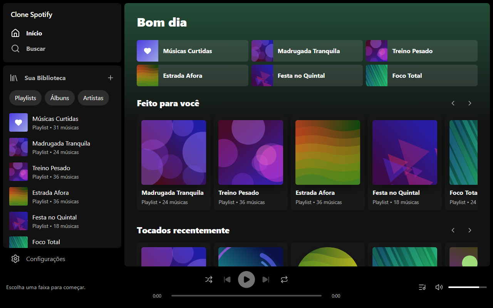
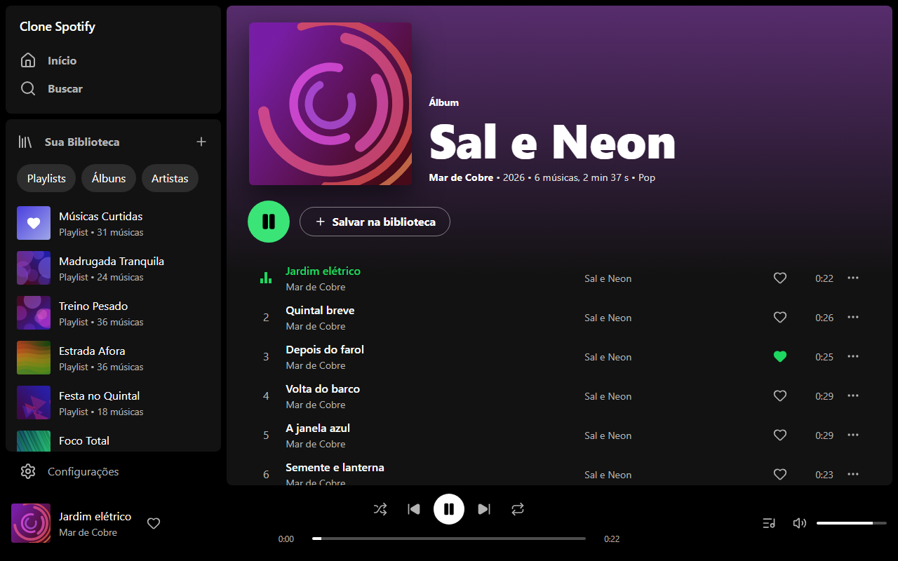
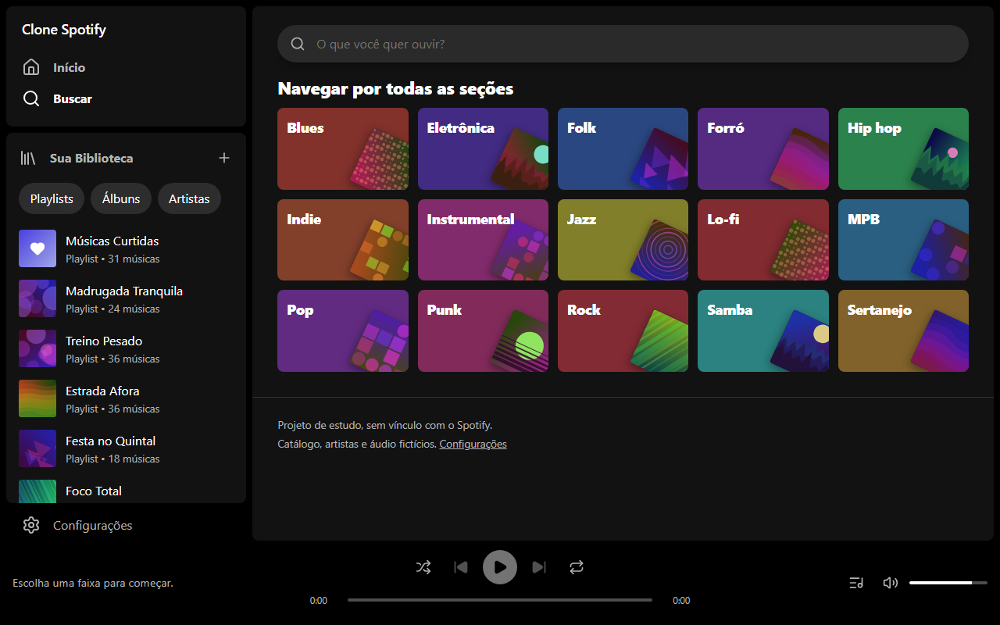
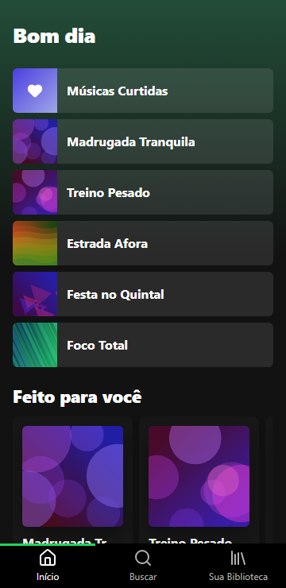
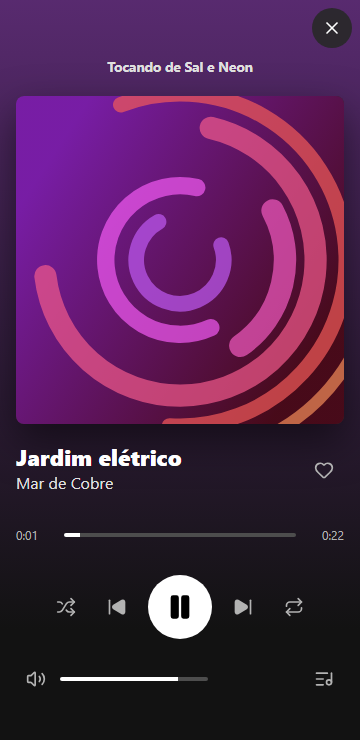
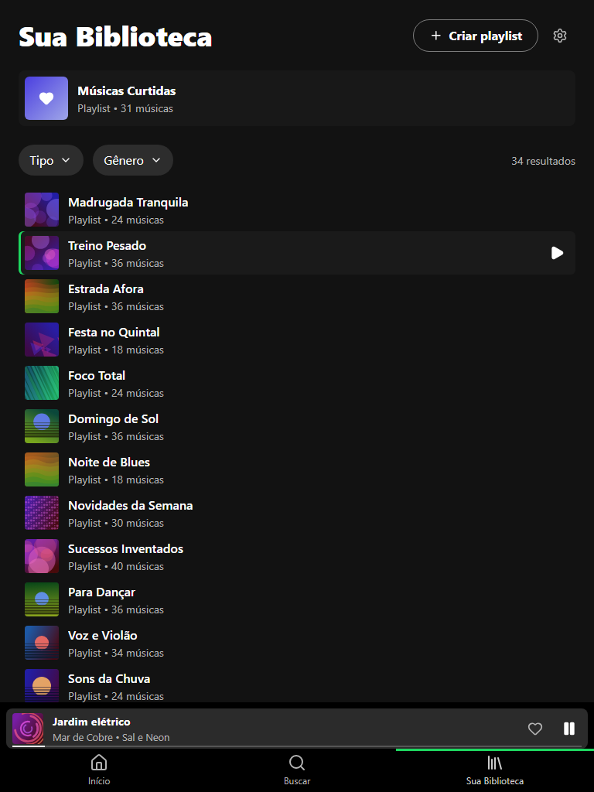

# Clone Spotify

Clone de estudo de um player de música web, feito em **React 19 + TypeScript + Vite**, sem backend. Artistas, álbuns, faixas, playlists e capas são **fictícios e gerados por código**, e o áudio é **instrumental original, sintetizado do zero** por um script deste repositório.

> **Projeto de estudo, sem vínculo com o Spotify.** Spotify e demais marcas citadas pertencem aos seus donos. Não há logotipo, capa, foto, música, nome de artista ou de álbum reais neste repositório, nem formulário de login, senha ou pagamento.

Demo: https://matheusfns27.github.io/clone-spotify/

## Capturas

| Início (1280 px) | Álbum tocando (1280 px) | Buscar (1280 px) |
|---|---|---|
|  |  |  |

| Início (360 px) | Player expandido (360 px) | Biblioteca (768 px) |
|---|---|---|
|  |  |  |

As demais capturas (360, 768 e 1280 px de cada tela) estão em [`docs/screenshots/`](docs/screenshots) e são regeneradas com `npm run capturas`.

## Funcionalidades

- **Layout fiel** ao original: no desktop, barra lateral com *Início*/*Buscar* e *Sua Biblioteca* rolável, área principal rolável e player fixo embaixo; no celular, navegação inferior, mini player acima dela e player expandido em tela cheia. Fundo preto, verde como cor principal e gradiente de cabeçalho derivado da capa. O nome aparece só como texto simples ("Clone Spotify").
- **Início**: saudação pelo horário de Brasília (`America/Sao_Paulo`), atalhos e carrosséis *Feito para você*, *Tocados recentemente* e *Lançamentos*.
- **Buscar**: cartões de gênero e resultados por faixa, artista, álbum e playlist, ignorando acento e maiúsculas. Os resultados têm paginação (25/50/100/200) e filtros em combobox de múltipla escolha (tipo e gênero).
- **Artista, Álbum, Playlist, Sua Biblioteca e Músicas Curtidas**, com navegação por *hash router* (voltar, avançar e recarregar preservam a tela; funciona no GitHub Pages sem rota no servidor).
- **Player único** com um `<audio>`: play/pausa, anterior/próxima, barra de progresso arrastável, volume e mudo, aleatório (sem repetir faixa até esgotar a fila), repetir (desligado, todas, uma), **fila visível e editável** (adicionar à fila, remover, reordenar por botões), curtir, tocar a partir de qualquer lista e **retomar após recarregar** (faixa e posição salvas, sem tocar sozinho).
- **Media Session API** (teclas de mídia, fones e tela de bloqueio) e **atalhos de teclado**: `Espaço` (fora de campos de texto), `Shift + →`, `Shift + ←` e `M`.
- **Biblioteca** em `localStorage`: criar, renomear e apagar playlists (em `<dialog>` nativo), adicionar e remover faixas, curtir faixas, seguir artistas e salvar álbuns.
- Faixa atual destacada nas listas, com indicador animado que respeita `prefers-reduced-motion`.

Padrões de interface: linhas e cards com realce no hover, botões com resposta ao passar o mouse e ao clicar, clique fora fecha modal e menus, clique na linha seleciona (duplo clique ou botão de play toca; em tela de toque, um toque toca), paginação de 25 por página (escolha salva e válida para o app inteiro) e filtros em combobox de múltipla escolha com busca. Carrosséis e faixas de álbum e playlist usam rolagem, sem paginação.

## O áudio é original

Nada foi baixado. O script [`scripts/gerar-audio.mjs`](scripts/gerar-audio.mjs) sintetiza **10 faixas instrumentais** (24 a 40 s cada) usando só JavaScript puro e o `ffmpeg`:

- cada faixa tem **tom, escala** (maior, menor, dórico, mixolídio, pentatônica), **progressão de acordes**, **andamento** (60 a 132 bpm) e **compasso** (4/4 ou 3/4) próprios;
- síntese aditiva: *pad* de acordes com vozes levemente desafinadas, baixo, **melodia "pluck" gerada por seed** (notas do acorde nos tempos fortes, passos pela escala nos demais) ou arpejo, e **percussão** simples (bumbo, caixa e chimbal de ruído) em oito padrões diferentes, incluindo valsa, shuffle, bossa e baião;
- reverb curto estéreo, fade-out e normalização;
- saída em **MP3 de 80 kbps** em `public/audio/` (cerca de 3 MB no total) e a **duração real** de cada arquivo (medida com `ffprobe`) em `src/data/audio.generated.ts`.

As 156 faixas do catálogo apontam para esses 10 arquivos em ciclo, com a duração real do arquivo. Para gerar de novo (precisa de `ffmpeg` e `ffprobe` no `PATH`):

```bash
npm run audio
```

O MP3 foi escolhido porque toca em todos os navegadores; o teste e2e confere que o Chromium do Playwright o decodifica e que `currentTime` realmente avança.

## Stack

React 19, TypeScript (strict), Vite 8, CSS próprio com variáveis (mobile-first, sem framework), `lucide-react` para ícones. Testes: Vitest + Testing Library e Playwright. Lint: ESLint 10 + typescript-eslint.

## Como rodar

Requer Node 24 e npm 11.

```bash
npm install
npm run dev        # http://localhost:5173/clone-spotify/
npm run build      # typecheck + build de produção em dist/
npm run preview
```

## Testes

```bash
npm run lint
npm run typecheck
npm test                          # Vitest: busca, fila, playlists, persistência, rotas, capas, componentes
npx playwright install chromium   # uma vez
npm run test:e2e                  # Playwright: fluxos e checagem de 360/768/1280 px
npm run capturas                  # regrava docs/screenshots (só quando quiser atualizar as imagens)
```

O e2e sobe o build com `vite preview` (porta 4175) e cobre: álbum → tocar → `currentTime` avançando → próxima → curtir → ver em *Curtidas* → criar playlist → recarregar e continuar; fila (adicionar, reordenar, remover); espaço, mudo, aleatório, repetir e progresso; paginação e filtros; hash router; o player móvel (um toque toca, mini player, player expandido); e, em 360, 768 e 1280 px, garante que `scrollWidth <= innerWidth` em todas as telas.

## Decisões técnicas

- **Sem rota de servidor**: `#/album/...`, `#/artista/...` etc. Links são `<a href="#/...">` comuns, então voltar/avançar e recarregar funcionam sem código extra.
- **Um único `<audio>`** dentro do `PlayerProvider`. A posição de reprodução fica em um contexto separado, para só a barra de progresso renderizar a cada tique.
- **Fila como funções puras** (`src/lib/queue.ts`): aleatório por embaralhamento (Fisher–Yates) da fila inteira com a faixa atual primeiro, então nada se repete até esgotar; com "repetir todas" a fila é embaralhada de novo na virada. Testada sem React.
- **Estado**: `localStorage` com prefixo `clone-spotify:`. Tudo que vem do armazenamento passa por validação (`sanitizeLibrary`, `sanitizeQueue`) antes de ser usado.
- **Estado inicial de demonstração**: a biblioteca não nasce vazia (31 curtidas, 12 artistas seguidos e 10 álbuns salvos) para a paginação aparecer. *Configurações → Restaurar dados de demonstração* volta a esse estado.
- **Catálogo**: nomes de artistas e álbuns escritos à mão; títulos de faixa gerados por seed a partir de listas de palavras com concordância de gênero (`src/data/titles.ts`). Capas SVG determinísticas (hash FNV-1a + PRNG mulberry32, 10 estilos de forma) entregues como `data:` URL.
- **Modal**: `<dialog>` com `showModal()`, `closedby="any"` e fallback para Safari; a rolagem da página não é travada.
- **Saudação** calculada com `Intl.DateTimeFormat` no fuso `America/Sao_Paulo`, independente do fuso do navegador.
- **TypeScript 6.0**: o `typescript-eslint` ainda não aceita o TypeScript 7, então o projeto fixa `typescript@~6.0`.

## Licença

[MIT](LICENSE) © 2026 Matheus.
